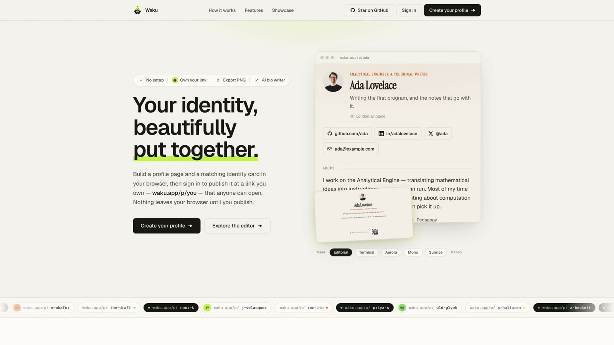
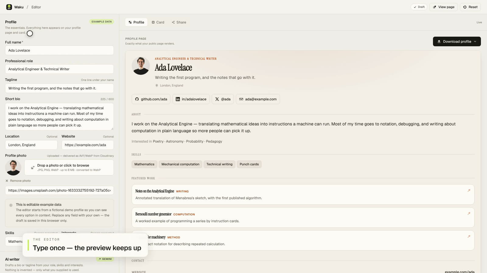
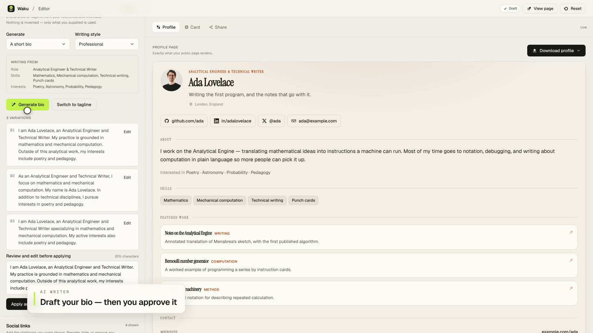
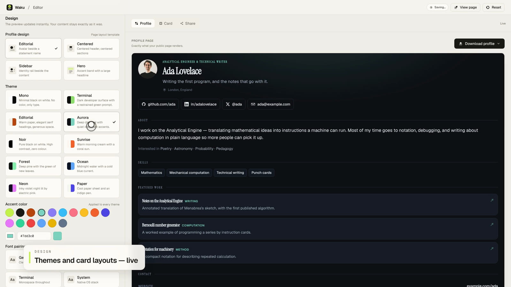
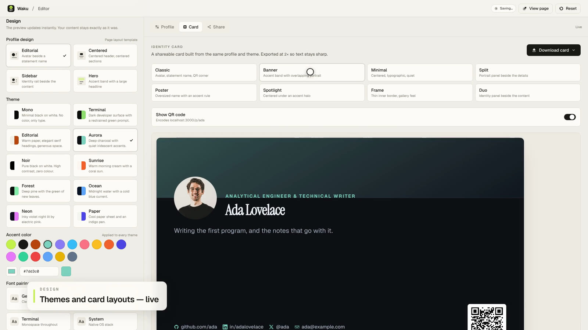
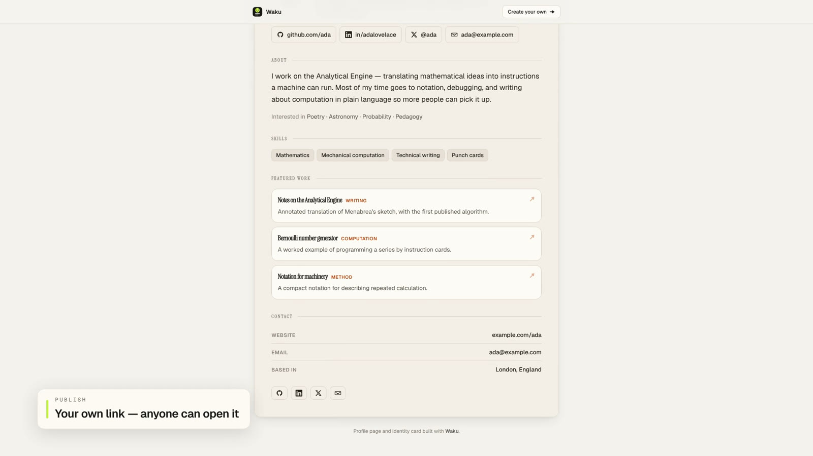

# Waku

**Your identity, beautifully put together.**

Waku turns a name, a role and a handful of links into two things: a designed,
themeable public profile page and a matching downloadable identity card —
with an AI bio writer, live theming, QR codes and multi-format export.

No account needed to build. Nothing leaves your browser until you publish.



<p align="center">
  <a href="public/media/waku-promo.mp4">Watch the 30s demo</a>
  ·
  <a href="https://github.com/Anos714/waku">GitHub</a>
</p>

---

## Table of contents

- [Highlights](#highlights)
- [Screenshots](#screenshots)
- [Tech stack](#tech-stack)
- [Quick start](#quick-start)
- [Environment variables](#environment-variables)
- [Commands](#commands)
- [Project structure](#project-structure)
- [Routes](#routes)
- [Architecture](#architecture)
- [Documentation](#documentation)
- [Deployment](#deployment)
- [Design system](#design-system)
- [Contact](#contact)

---

## Highlights

- **Local-first editor** — every keystroke is saved to `localStorage`
  (debounced, 350 ms) and restored on refresh. Anonymous drafts are claimed as
  your first published page when you sign in for the first time.
- **Live preview** — the editor preview and the public page are the *same*
  React component (`ProfileView`), so what you edit is exactly what ships.
- **Publishing with ownership** — sign in with GitHub or Google, hit publish,
  and the profile goes live at `/p/<slug>`. The slug is assigned by the server,
  never chosen by the client.
- **10 themes × 8 font pairings × 16 accents × 8 backgrounds × 6 social button
  styles** — applied as CSS custom properties; switching never touches content.
- **4 page designs** — Editorial, Centered, Sidebar, Hero.
- **8 identity-card layouts** — Classic, Banner, Minimal, Split, Poster,
  Spotlight, Frame, Duo — exported as PNG, JPEG, WebP or AVIF at 2× pixel
  density.
- **AI bio & tagline writer** — Google Gemini, called server-side only. The
  prompt is constrained to facts already in your profile; it may not invent
  employers, metrics or credentials. Returns three variations you approve
  individually.
- **QR codes & sharing** — profile QR colored from the profile's own theme
  palette, clipboard copy, Web Share, and a plain text export of the whole
  profile.
- **Photo uploads** — Cloudinary with server-side signing; AVIF/WebP delivery
  with face-focused cropping.
- **Graceful degradation** — no database, no OAuth secrets, no Gemini key? The
  app runs, drafts work, and the UI reports exactly what is missing instead of
  failing mid-flow.

## Screenshots

| Editor with live preview | AI bio writer |
| --- | --- |
|  |  |

| Themes & card layouts | Identity card with QR |
| --- | --- |
|  |  |

| Published profile page |
| --- |
|  |

## Tech stack

| Layer | Choice |
| --- | --- |
| Framework | Next.js 16 (App Router, Turbopack, React Compiler) |
| UI | React 19, TypeScript (strict) |
| Styling | Tailwind CSS v4 (CSS-first config in `app/globals.css`) |
| Primitives | Radix UI + shadcn-style wrappers in `components/ui/` |
| Forms | react-hook-form + Zod v4 (`zodResolver`) |
| Database | Neon Postgres (`@neondatabase/serverless`, HTTP driver) |
| ORM | Drizzle ORM — schema created by idempotent `ensureSchema()` |
| Auth | Better Auth (social-only: GitHub, Google) |
| AI | Google Gemini via `@google/genai` (server-only) |
| Uploads | Cloudinary (signed server-side), `next-cloudinary` delivery |
| Export / QR | `html-to-image`, `qrcode` |
| Package manager | pnpm |

## Quick start

Requirements: **Node 20.9+**, **pnpm 12+**. Every environment variable is
optional — the app boots with an empty `.env.local`.

```bash
pnpm install
cp .env.example .env.local   # fill in what you need; GEMINI_API_KEY is a good first one
pnpm dev
```

Open [http://localhost:3000](http://localhost:3000). The editor is at
[`/create`](http://localhost:3000/create), and a bundled demo profile renders at
[`/p/ada`](http://localhost:3000/p/ada) without any database.

To exercise the full loop (publish → public URL), add `DATABASE_URL`,
`BETTER_AUTH_SECRET`, `BETTER_AUTH_URL` and one OAuth provider — see
[docs/deployment.md](docs/deployment.md).

## Environment variables

All values live in `.env.local` (gitignored). Full annotated copy in
[`.env.example`](.env.example).

| Variable | Required for | Notes |
| --- | --- | --- |
| `DATABASE_URL` | Publishing, accounts, showcase | Neon Postgres connection string. Without it the editor runs on local drafts and publishing returns `503 MISSING_DATABASE`. |
| `BETTER_AUTH_SECRET` | Sign-in | Session signing secret. `openssl rand -base64 32`. |
| `BETTER_AUTH_URL` | Sign-in | Public origin of the instance, e.g. `http://localhost:3000`. Checked against the sign-in request's origin. |
| `GITHUB_CLIENT_ID` / `GITHUB_CLIENT_SECRET` | GitHub sign-in | [Create an OAuth app](https://github.com/settings/developers). Left blank → the button is hidden. |
| `GOOGLE_CLIENT_ID` / `GOOGLE_CLIENT_SECRET` | Google sign-in | [OAuth client credentials](https://console.cloud.google.com/apis/credentials). Left blank → the button is hidden. |
| `GEMINI_API_KEY` | AI bio/tagline writer | Server-side only. Get one at [aistudio.google.com/app/apikey](https://aistudio.google.com/app/apikey). |
| `GEMINI_MODEL` | Optional | Defaults to `gemini-3.8-flash`. |
| `CLOUDINARY_CLOUD_NAME` / `CLOUDINARY_API_KEY` / `CLOUDINARY_API_SECRET` | Photo uploads | Server-side signing in `app/api/upload/route.ts`. The secret never reaches the browser. |
| `NEXT_PUBLIC_CLOUDINARY_CLOUD_NAME` | Photo delivery | Browser-exposed cloud name used to build AVIF/WebP URLs from a stored public ID. |

## Commands

```bash
pnpm dev        # dev server (Turbopack)
pnpm build      # production build
pnpm start      # serve the production build
pnpm lint       # eslint (flat config, next/core-web-vitals + next/typescript)
pnpm typecheck  # tsc --noEmit (strict)
```

There is no test suite yet — the definition of done is `typecheck` + `lint` +
`build`, all clean.

## Project structure

```
app/
  page.tsx                    Landing (server component, revalidate 300)
  create/page.tsx             Editor route
  p/[slug]/page.tsx           Public profile (SSR + client fallback)
  opengraph-image.tsx         Generated 1200×630 OG/Twitter card
  api/
    auth/[...all]/route.ts    Better Auth handler (ensures schema first)
    profiles/route.ts         POST — publish (session required)
    profiles/claim-draft/     POST — claim an anonymous draft on first sign-in
    ai/bio/route.ts           POST — Gemini bio/tagline generation
    upload/route.ts           POST — signed Cloudinary upload
    config/route.ts           GET  — auth/provider availability (non-sensitive)
components/
  landing/                    Nav, hero, promo video, steps, features, showcase, CTA
  editor/                     Editor shell, form sections, AI writer, theming, share panel
  profile/                    ProfileView (shared renderer), designs, avatars, sections
  cards/                      Identity card, 8 layouts, export menus
  ui/                         Radix-based primitives
  icons/                      Brand + platform glyphs
lib/
  db.ts                       Drizzle client, ensureSchema(), publish/read queries
  db/schema.ts                profiles + Better Auth tables
  ai/gemini.ts                Server-only Gemini client (facts-only prompt)
  validation/profile.ts       Zod schemas, URL safety
  themes/index.ts             Theme/font/accent presets + resolveTheme()
  profile/                    storage, slug, qr, format, demo, platforms, data access
  cards/export.ts             html-to-image export (dynamic import)
types/index.ts                Domain models (Profile, ThemeSettings, …)
proxy.ts                      Optimistic cookie gate on POST /api/profiles*
docs/                         Architecture, API and deployment notes
```

## Routes

| Route | Purpose |
| --- | --- |
| `/` | Landing page with hero demo, feature tour and recent published profiles |
| `/create` | Profile editor: form + live preview + card studio + share panel |
| `/p/[slug]` | Public profile page (demo: `/p/ada`) |
| `/api/auth/[...all]` | Better Auth — sign-in, callback, session, sign-out |
| `/api/profiles` | `POST` — publish a profile (session required) |
| `/api/profiles/claim-draft` | `POST` — import the local draft as your first page |
| `/api/ai/bio` | `POST` — AI bio/tagline generation |
| `/api/upload` | `POST` — signed profile photo upload |
| `/api/config` | `GET` — `{ authEnabled, providers }` for the UI |

Full request/response contracts, error codes and status ladders:
**[docs/api.md](docs/api.md)**.

## Architecture

The short version:

- **One renderer, two consumers.** `ProfileView` renders both the editor
  preview and `/p/[slug]`. There is no second implementation to drift.
- **Themes are tokens, not branches.** `resolveTheme()` turns a
  `ThemeSettings` object into a flat map of CSS custom properties
  (`--pt-*`) applied to the profile container. Switching a theme rewrites
  tokens; content and markup are untouched.
- **Drafts are local until you publish.** The editor writes to
  `localStorage` (`waku.draft.v1`, with migration from `linkpersona.draft.v1`
  and a salvage path for corrupt drafts). Publishing is the only write path to
  the database, and it requires a session.
- **The server owns slugs and secrets.** Slugs are generated server-side
  (kebab-case name + nanoid, retried on collision) and ownership is decided
  against the database. The Gemini key, Cloudinary secret and OAuth secrets
  never leave the server.
- **Every handler validates and degrades.** Zod first, a uniform
  `{ ok, code, message, hint }` error envelope, and an actionable `503` when a
  dependency is unconfigured — never a stack trace.
- **URLs are sanitized.** Only `http`, `https`, `mailto` and `tel` pass
  `safeExternalUrl`, so an unsafe scheme can never render on a public profile.

Deep dive: **[docs/architecture.md](docs/architecture.md)**.

## Documentation

| Document | What's in it |
| --- | --- |
| [docs/architecture.md](docs/architecture.md) | Rendering pipeline, theme token system, state management, data flow, auth, security model |
| [docs/api.md](docs/api.md) | Every endpoint: request/response shapes, status codes, error codes |
| [docs/deployment.md](docs/deployment.md) | Production environment setup, OAuth configuration, degradation matrix, release checklist |
| [LANDING_PROMPT.md](LANDING_PROMPT.md) | Historical product/design brief for the landing page (context, not docs) |

## Deployment

Any host that runs `next build` / `next start` works — there is no vendor lock
beyond Neon for the database. Minimum for a useful production instance:

1. `DATABASE_URL` (Neon) — publishing, accounts, showcase.
2. `BETTER_AUTH_SECRET` + `BETTER_AUTH_URL` — sessions.
3. One OAuth provider, with its callback URL pointed at
   `https://<your-domain>/api/auth/callback/<provider>` (Better Auth's default
   path under its `/api/auth` base path).
4. `GEMINI_API_KEY` if you want the AI writer; `CLOUDINARY_*` if you want photo
   uploads.

Without the database the app still runs: the editor, all themes, card export
and QR work entirely client-side. Full setup guide and checklist:
**[docs/deployment.md](docs/deployment.md)**.

## Design system

Warm off-white canvas (`#f5f3ee`), near-black ink (`#1a1a16`), deep charcoal
surfaces and a single restrained electric-lime accent (`#c6f24e`).

Profile rendering is fully tokenised:

- **10 themes** — Mono, Terminal, Editorial, Aurora, Noir, Sunrise, Forest,
  Ocean, Neon, Paper
- **8 font pairings** — Geist, Editorial, Terminal, System, Playfair,
  Grotesque, Lora, JetBrains
- **16 accent presets** + free-form hex
- **8 background treatments** — plain, subtle glow, grid, aurora glow, dots,
  stripes, mesh, rings
- **6 social button styles** — minimal, outline, solid, soft, elevated,
  underline
- **4 page designs**, **8 card layouts**
- 9 social platforms with canonical metadata (GitHub, LinkedIn, X, Instagram,
  YouTube, Bluesky, Mastodon, portfolio, email)

All presets live in `lib/themes/index.ts` and `components/*/…`; tokens are
declared in `app/globals.css`.

## Contact

Built by **Anos714**.

- **GitHub:** [github.com/Anos714](https://github.com/Anos714) — issues and
  pull requests are welcome there.
- **Email:** [sainrahul374@gmail.com](mailto:sainrahul374@gmail.com)
- **X:** [x.com/RahulSain714](https://x.com/RahulSain714)
- **LinkedIn:** [linkedin.com/in/rahulxcode](https://www.linkedin.com/in/rahulxcode)

Found a bug or have a feature in mind? Open an issue on
[GitHub](https://github.com/Anos714/waku/issues).
